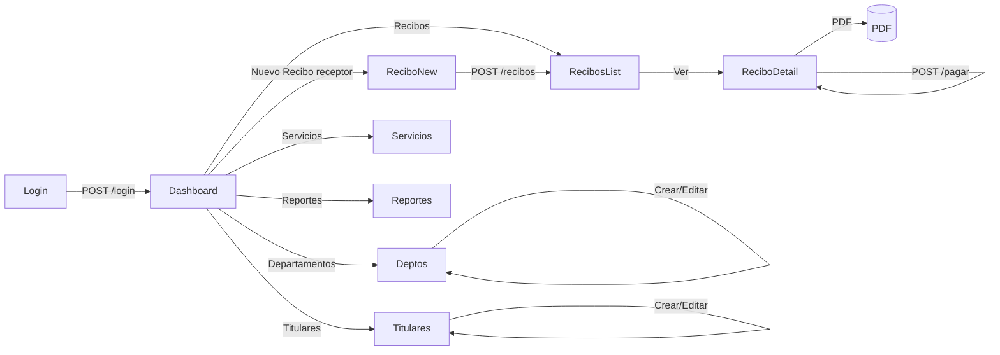

# Mapa de Pantallas — RecibosGo

## Navegación actual (v2.1)

## Menú (layout.html)

**Desktop / Móvil** (breakpoint < 768px muestra hamburguesa ☰):

- **Dashboard** — todos los roles
- **Departamentos** — solo `administrador` (y `dueño`/`dueno` por ruta)
- **Titulares** — solo `administrador`
- **Servicios** — solo `administrador`
- **Reportes** — solo `administrador`
- **Nuevo Recibo** — solo `receptor`
- **Recibos** — todos los roles autenticados
- **Deudas** — todos los roles autenticados (generar solo `administrador`/`receptor`)
- **Salir (email)** — POST /logout

## Tabla de rutas

### Públicas

| Método | Ruta | Handler | Template | Roles |
|---|---|---|---|---|
| GET | `/login` | `LoginPage` | `login.html` | público |
| POST | `/login` | `Login` | — | público |
| POST | `/logout` | `Logout` | — | autenticado |
| GET | `/static/*` | FileServer | — | público |

### Autenticadas

| Método | Ruta | Handler | Template | Fragmentos | Roles |
|---|---|---|---|---|---|
| GET | `/` | redirect `/dashboard` | — | — | autenticado |
| GET | `/dashboard` | `Dashboard` | `dashboard.html` | — | todos |
| GET | `/departamentos` | `DepartamentosList` | `departamentos.html` | `deptos_table`, `paginador` | admin, dueño, dueno |
| GET | `/departamentos/{id}/historial` | `DepartamentoHistorial` | `departamento_historial.html` | — | admin, dueño, dueno |
| POST | `/departamentos` | `DepartamentoCreate` | — | — | admin, dueño, dueno |
| POST | `/departamentos/{id}` | `DepartamentoUpdate` | — | — | admin, dueño, dueno |
| GET | `/personas` | `PersonasList` | `titulares.html` | `personas_table` | admin |
| POST | `/personas` | `PersonaCreate` | — | — | admin |
| POST | `/personas/{id}` | `PersonaUpdate` | — | — | admin |
| GET | `/servicios` | `ServiciosList` | `servicios.html` | — | admin |
| POST | `/servicios` | `ServicioCreate` | — | — | admin |
| POST | `/servicios/{id}` | `ServicioUpdate` | — | — | admin |
| GET | `/reportes` | `Reportes` | `reportes.html` | `reportes_content`, `paginador` | admin |
| GET | `/recibos` | `RecibosList` | `recibos_list.html` | `recibos_table`, `paginador` | todos |
| GET | `/recibos/new` | `ReciboNew` | `recibo_create.html` | `item_row` | admin, dueño, dueno, inquilino, receptor |
| POST | `/recibos` | `ReciboCreate` | — | — | admin, dueño, dueno, inquilino, receptor |
| GET | `/recibos/item-row` | `ReciboItemRow` | — | `item_row` | todos |
| GET | `/recibos/{id}` | `ReciboDetail` | `recibo_detail.html` | `recibo_detalle` | todos |
| GET | `/recibos/{id}/pdf` | `ReciboPDF` | PDF | — | todos |
| POST | `/recibos/{id}/pagar` | `ReciboPagar` | — | `recibo_detalle` | todos |
| GET | `/deudas` | `DeudasList` | `deudas.html` | `deudas_table`, `paginador` | todos |
| POST | `/deudas` | `DeudaGenerar` | — | — | admin, receptor |

## Referencia rápida por pantalla

| Pantalla | Archivo doc |
|---|---|
| Login | [login.md](./pantallas/login.md) |
| Dashboard | [dashboard.md](./pantallas/dashboard.md) |
| Departamentos | [departamentos.md](./pantallas/departamentos.md) |
| Titulares | [titulares.md](./pantallas/titulares.md) |
| Servicios | [servicios.md](./pantallas/servicios.md) |
| Nuevo recibo | [recibos-nuevo.md](./pantallas/recibos-nuevo.md) |
| Listado de recibos | [recibos-listado.md](./pantallas/recibos-listado.md) |
| Detalle de recibo | [recibo-detalle.md](./pantallas/recibo-detalle.md) |
| Reportes | [reportes.md](./pantallas/reportes.md) |
| Deudas | [deudas.md](./pantallas/deudas.md) |
