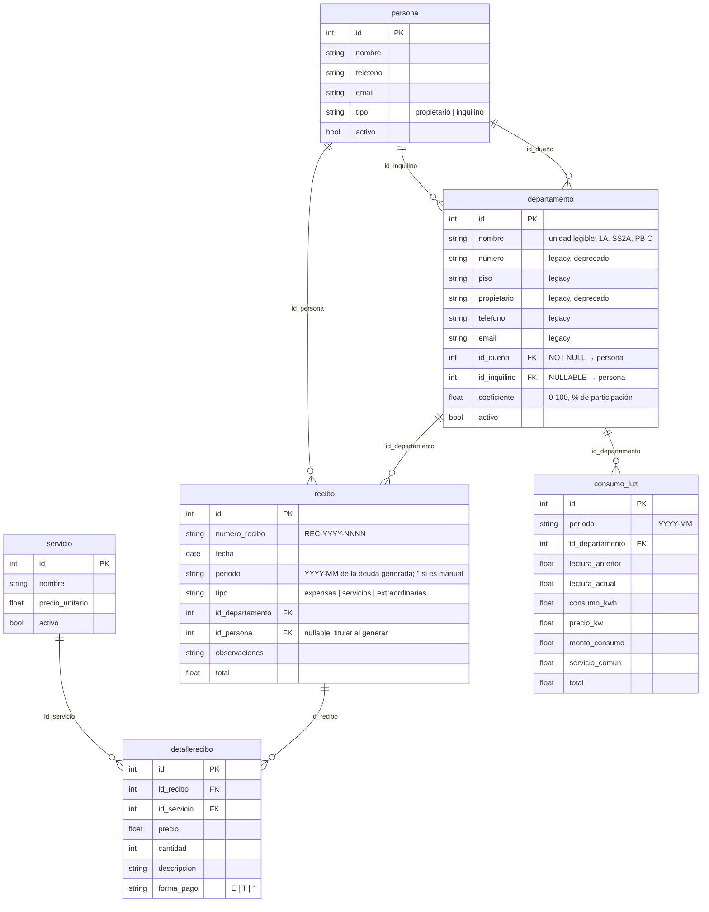

# Modelo de Datos — RecibosGo

## Estado actual (v2.1 — implementado)

### Datos actuales (mp135.db)

| Tabla | Filas | Observaciones |
|---|---|---|
| `departamento` | 104 | 104 unidades registradas |
| `persona` | ~88 | Creadas desde CSV (propietarios + inquilinos) |
| `recibo` | 5.690 | 239 con `id_departamento = 0` (huérfanos) |
| `detallerecibo` | 7.860 | |
| `users` | 1+ | Solo auth (admin seed) |

### Diccionario de tablas

**`departamento`** — una fila por unidad física del edificio.
- `id` PK
- `nombre` — unidad legible (`1A`, `2B`, `SS2A`, `PB C`). Campo de identificación principal.
- `numero` — código legacy; conservado (regla 1:1) pero deprecado.
- `piso`, `propietario`, `telefono`, `email` — legacy; `propietario` deja de ser fuente primaria.
- `id_dueño` FK → `persona.id` — propietario de la unidad (NOT NULL).
- `id_inquilino` FK → `persona.id` — inquilino actual (NULLABLE).
- `activo` — baja lógica.

**`persona`** — titular normalizado (propietario o inquilino).
- `id` PK, `nombre`, `telefono`, `email`
- `tipo` — `propietario | inquilino` (clasificación principal de la persona).
- `activo`

**`recibo`** — documento por unidad.
- `id_departamento` FK (1 recibo = 1 unidad; se conserva).
- `id_persona` FK nullable — titular al momento de generar. NULL en recibos legacy.
- El resto no cambia.

**`detallerecibo`** — líneas de un recibo. Sin cambios.

**`consumo_luz`** — lectura y cálculo de luz EDET por unidad y período.
- `periodo` + `id_departamento` — clave única.
- `lectura_anterior`, `lectura_actual`, `consumo_kwh` — datos del medidor.
- `precio_kw`, `monto_consumo`, `servicio_comun`, `total` — resultado de la generación de servicios.

**`servicio`** — catálogo de servicios. Sin cambios.

**`users`** — solo autenticación. Sin cambios.

### Relaciones clave

| Relación | Tipo | Descripción |
|---|---|---|
| `persona` → `departamento` (id_dueño) | 1:N | Un propietario puede tener múltiples unidades |
| `persona` → `departamento` (id_inquilino) | 1:N | Un inquilino puede estar en múltiples unidades |
| `departamento` → `recibo` | 1:N | Cada recibo pertenece a una unidad |
| `persona` → `recibo` (id_persona) | 1:N | Titular al momento de generar (nullable) |

### Mapeo legacy → v2.1

| Fuente (recibos2026.sql / CSV) | Destino (v2.1) | Regla |
|---|---|---|
| CSV `DEPTO` | `departamento.nombre` | Copia directa |
| CSV `PROPIETARIO` | `persona.nombre` + `departamento.id_dueño` | Crear persona, vincular |
| CSV `INQUILINO` | `persona.nombre` + `departamento.id_inquilino` | Crear persona si existe, vincular |
| `departamento.propietario` | Legacy conservado | No se borra (regla 1:1) |
| `departamento.numero` | Legacy conservado | No se borra (regla 1:1) |

Detalle del parser en [migraciones.md](./migraciones.md).
