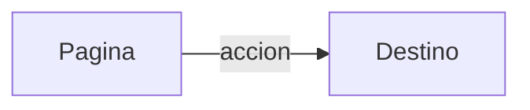

# Plantilla de especificación de pantalla

> Esta plantilla es el formato estándar para documentar cada pantalla del sistema. Copiar este archivo a `docs/pantallas/{nombre}.md`, completar todas las secciones y borrar las secciones que no apliquen. Un agente de IA debe poder reconstruir la pantalla completa leyendo SOLO este archivo + los documentos de arquitectura y modelo de datos.

---

# Pantalla: {Nombre}

## 1. Identificación

| Campo | Valor |
|---|---|
| Ruta | `METHOD /path` |
| Handler | `handlers.NombreHandler` (archivo: `internal/handlers/archivo.go`) |
| Template | `templates/{pagina}.html` |
| Fragmentos HTMX | `templates/fragments/{fragmento}.html`, `paginador.html` |
| Roles | `administrador`, `dueño`, `inquilino`, `receptor` |
| Propósito | 1 o 2 líneas: qué hace y para quién |
| Acceso | pública / autenticado / rol |

## 2. Datos involucrados

- Modelos: `models.X`, `models.Y`
- Queries principales: describir qué consulta el handler (preloads, filtros, orden).
- Restricciones por rol: qué filtra el query según el `user.Role`.

## 3. Formulario / Filtros

| Campo | Tipo | Obligatorio | Notas |
|---|---|---|---|
| `nombre` | text | sí | ... |

## 4. Acciones y navegación

| Acción | Destino | Método | HTMX | Target |
|---|---|---|---|---|
| Guardar | `/path` | POST | no | — |
| Buscar | `/path?q=` | GET | sí | `#id-target` |

## 5. Flujo (mermaid)

## 6. Estado actual vs objetivo

- **Actual (v2.0):** ...
- **Objetivo (v2.1):** ...

## 7. Pendientes / notas

- ...
