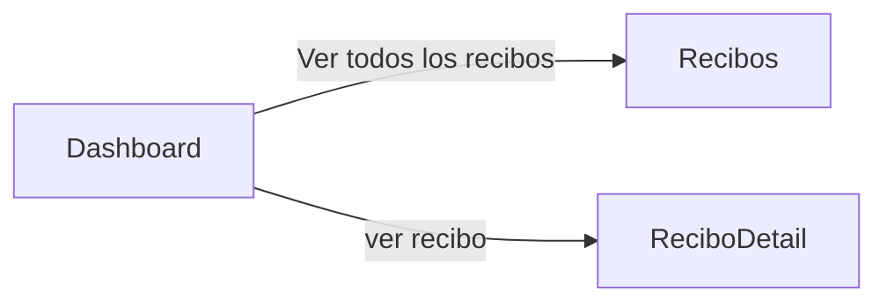

# Pantalla: Dashboard

## 1. Identificación

| Campo | Valor |
|---|---|
| Ruta | `GET /dashboard` |
| Handler | `Dashboard` (`internal/handlers/dashboard.go`) |
| Template | `templates/dashboard.html` |
| Fragmentos | ninguno |
| Roles | administrador, dueño, dueno, inquilino, receptor |
| Propósito | Métricas globales (admin/receptor) o resumen propio (dueño/inquilino) + últimos 10 recibos |
| Acceso | autenticado |

## 2. Datos involucrados

- Modelos: `Recibo`, `Departamento`, `Servicio`
- Queries:
  - `RecibosCount`: `count(recibo)` (global).
  - Últimos recibos: `preload(Departamento).preload(Detalles).order(fecha desc).limit(10)`.
  - Admin/receptor: `count(departamento activo)` y `count(servicio activo)`.
  - Dueño/inquilino: `departamento WHERE email = user.email` → filtra recibos por `id_departamento IN ids`.

## 3. Métricas mostradas

| Métrica | Admin/Receptor | Dueño/Inquilino |
|---|---|---|
| Total recibos | ✅ | ❌ |
| Departamentos activos | ✅ | ❌ |
| Servicios activos | ✅ | ❌ |
| Resumen de unidades propias | ❌ | ✅ (tarjetas por unidad) |
| Últimos 10 recibos | ✅ | ✅ (solo propios) |

> AGENTS.md prevé además: total expensas, total servicios separados, total deuda. Aún no implementados.

## 4. Acciones y navegación

| Acción | Destino | Método | HTMX |
|---|---|---|---|
| Ver recibos | `/recibos` | GET | no |
| Ver detalle de recibo | `/recibos/{id}` | GET | no |

## 5. Flujo

## 6. Estado actual vs objetivo

- **Actual:** métricas básicas de conteo; unidad mostrada con `trimNumero .Numero` (código legacy).
- **Objetivo (v2.1):** usar `departamento.nombre` para la unidad y mostrar el titular desde `persona`. Restricción de depto propios pasará de `email` a relación `user → persona → departamento_persona`.

## 7. Pendientes / notas

- Implementar métricas de montos (expensas, servicios, deuda) del AGENTS.md.
- Cambiar filtro de unidades propias (hoy por email).
