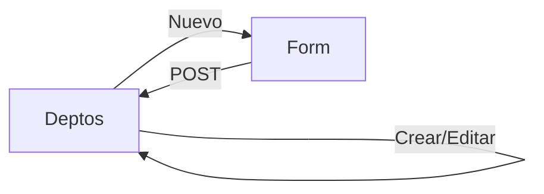

# Pantalla: Departamentos

## 1. Identificación

| Campo | Valor |
|---|---|
| Ruta | `GET /departamentos` (listado), `POST /departamentos` (crear), `POST /departamentos/{id}` (editar) |
| Handler | `DepartamentosList`, `DepartamentoCreate`, `DepartamentoUpdate` (`internal/handlers/departamentos.go`) |
| Template | `templates/departamentos.html` |
| Fragmentos | `deptos_table.html`, `paginador.html` |
| Roles | administrador, dueño, dueno |
| Propósito | CRUD de unidades del edificio con búsqueda y paginación |
| Acceso | rol (middleware `RequireRole("administrador","dueño","dueno")`) |

## 2. Datos involucrados

- Modelo: `models.Departamento`
- Queries:
  - Listado: búsqueda `q` sobre `numero`, `piso`, `propietario`; orden por `numero ASC`; paginado (`perPage = 25`).
  - Editar: `GET /departamentos?edit={id}` carga el registro en `data.Edit`.

## 3. Formulario / Filtros

| Campo | Tipo | Obligatorio | Notas |
|---|---|---|---|
| Búsqueda `q` | text | no | numero, piso, propietario |
| `numero` | text | sí | **legacy**: código de la unidad |
| `piso` | text | no | |
| `propietario` | text | no | **legacy**: texto combinado |
| `telefono` | text | no | |
| `email` | email | no | |
| `activo` | checkbox | no | default checked |

## 4. Acciones y navegación

| Acción | Destino | Método | HTMX | Target |
|---|---|---|---|---|
| Buscar | `/departamentos?q=` | GET | sí | `#deptos-table` |
| Crear | `/departamentos` | POST | no | — |
| Editar | `/departamentos/{id}` | POST | no | — |
| Editar (formulario) | `/departamentos?edit={id}` | GET | no | — |
| Ver recibos | `/departamentos/{id}/recibos` | — | — | planificado en AGENTS.md, no implementado |

## 5. Flujo

## 6. Estado actual vs objetivo

- **Actual:** la columna "Nº" muestra `numero` (código legacy 1..104); no existe unidad legible.
- **Objetivo (v2.1):**
  - Nuevo campo `nombre` = unidad (`1A`, `SS2A`, `PB C`), mostrado como "Unidad".
  - `numero`, `propietario`, `piso`, `telefono`, `email` pasan a legacy (se conservan, se ocultan del form o se marcan).
  - Búsqueda y orden por `nombre`.
  - Acción "Asignar titulares" por fila → `/departamentos/{id}/titulares`.
  - Cargar `propietario` de la unidad desde `persona` (vía `departamento_persona`).
