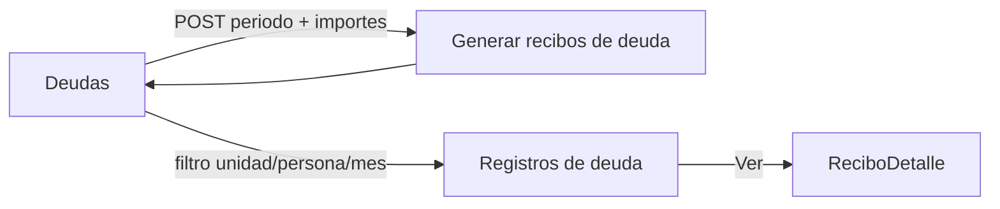

# Pantalla: Deudas

## 1. Identificación

| Campo | Valor |
|---|---|
| Ruta | `GET /deudas`, `POST /deudas` |
| Handler | `handlers.DeudasList`, `handlers.DeudaGenerar` (`internal/handlers/deudas.go`) |
| Template | `templates/deudas.html` |
| Fragmentos HTMX | `templates/fragments/deudas_table.html`, `paginador.html` |
| Roles | GET: todos los autenticados (filtrado por rol). POST: `administrador`, `receptor` |
| Propósito | Generar la deuda mensual por unidad (expensas + SAT/CISI prorrateados por coeficiente) y consultar los registros de deuda por unidad o persona. |
| Acceso | autenticado |

## 2. Datos involucrados

- Modelos: `models.Recibo` (`periodo`), `models.DetalleRecibo`, `models.Servicio`, `models.Departamento` (`coeficiente`), `models.Persona`.
- Queries principales:
  - Listado: `recibo` con `periodo <> ''`, preload `Departamento.Dueño` y `Detalles.Servicio`, orden `fecha DESC, id DESC`, paginado de 25.
  - Generación: unidades `activo = true AND coeficiente > 0`.
- Restricciones por rol: `dueño`/`inquilino` solo ven deudas de los departamentos donde son `id_dueño` o `id_inquilino` (persona vinculada por email). `administrador`/`receptor` ven todo.

## 3. Formulario / Filtros

| Campo | Tipo | Obligatorio | Notas |
|---|---|---|---|
| `periodo` | month | sí | Formato `AAAA-MM`; evita duplicados por período. |
| `total_expensas` | number | sí | Total mensual de expensas del edificio. |
| `total_sat_cisi` | number | sí | Total mensual de SAT + CISI. |
| `departamento` | select | no | Filtro de consulta por unidad. |
| `persona` | select | no | Filtro de consulta por titular (dueño o inquilino). |
| `mes` | month | no | Filtro de consulta por período. |

Cálculo por unidad: `monto = total * coeficiente / 100`, redondeado a 2 decimales. Se crea un `recibo` por unidad con `periodo` y hasta dos `detallerecibo` (servicios `Expensas Comunes. Pago Final` y `Servicios. Pago Final`).

## 4. Acciones y navegación

| Acción | Destino | Método | HTMX | Target |
|---|---|---|---|---|
| Generar deudas | `/deudas` | POST | no | — |
| Filtrar | `/deudas?departamento=&persona=&mes=` | GET | sí | `#deudas-table` |
| Ver recibo | `/recibos/{id}` | GET | no | — |

## 5. Flujo (mermaid)

## 6. Estado actual vs objetivo

- **Actual (v2.1):** generación mensual por coeficiente y consulta por unidad/persona implementadas.
- **Objetivo (reemplazo de la planilla):** los importes de expensas y SAT/CISI se cargan en el sistema y generan los registros de deuda por unidad, sin usar `ExpensasMP 2026.xlsx`.

## 7. Pendientes / notas

- Cargar el `coeficiente` de cada unidad en Departamentos (no se importa automáticamente desde el Excel).
- No se migran `deuda_luz`, `multa` ni pagos históricos de la planilla.
- Un período ya generado no se puede regenerar (devuelve aviso); borrar los recibos del período para reintentar.
