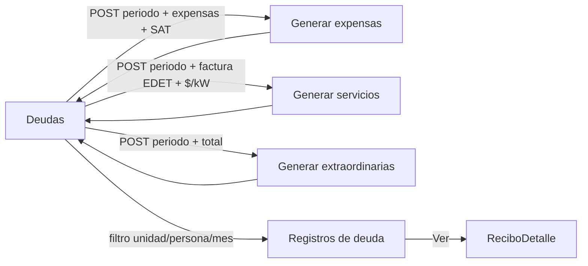

# Pantalla: Deudas

## 1. Identificación

| Campo | Valor |
|---|---|
| Ruta | `GET /deudas`, `POST /deudas`, `POST /deudas/servicios`, `POST /deudas/extraordinarias` |
| Handler | `handlers.DeudasList`, `handlers.DeudaGenerar`, `handlers.ServicioGenerar`, `handlers.ExtraordinariaGenerar` (`internal/handlers/deudas.go`) |
| Template | `templates/deudas.html` |
| Fragmentos HTMX | `templates/fragments/deudas_table.html`, `paginador.html` |
| Roles | GET: todos los autenticados (filtrado por rol). POST: `administrador`, `receptor` |
| Propósito | Generar la deuda mensual por unidad (expensas + SAT/CISI, servicios EDET y expensas extraordinarias) y consultar los registros por unidad o persona. |
| Acceso | autenticado |

## 2. Datos involucrados

- Modelos: `models.Recibo` (`periodo`, `tipo`), `models.DetalleRecibo`, `models.Servicio`, `models.Departamento` (`coeficiente`), `models.ConsumoLuz`, `models.Persona`.
- Queries principales:
  - Listado: `recibo` con `periodo <> ''`, preload `Departamento.Dueño` y `Detalles.Servicio`, orden `fecha DESC, id DESC`, paginado de 25.
  - Expensas: unidades `activo = true AND coeficiente > 0`.
  - Servicios: lecturas `consumo_luz` del período (preload `Departamento`).
- Restricciones por rol: `dueño`/`inquilino` solo ven deudas de los departamentos donde son `id_dueño` o `id_inquilino` (persona vinculada por email). `administrador`/`receptor` ven todo.

## 3. Formulario / Filtros

**Generar expensas**

| Campo | Tipo | Obligatorio | Notas |
|---|---|---|---|
| `periodo` | month | sí | `AAAA-MM`; evita duplicados (`tipo = 'expensas'`). |
| `total_expensas` | number | sí | Total mensual de expensas del edificio. |
| `total_sat_cisi` | number | sí | Total mensual de SAT + CISI. |

**Generar servicios (luz EDET)**

| Campo | Tipo | Obligatorio | Notas |
|---|---|---|---|
| `periodo` | month | sí | `AAAA-MM`; requiere lecturas en `consumo_luz`. |
| `total_factura` | number | sí | Importe total de la factura EDET. |
| `precio_kw` | number | sí | Precio del kW del período. |

**Generar expensas extraordinarias**

| Campo | Tipo | Obligatorio | Notas |
|---|---|---|---|
| `periodo` | month | sí | `AAAA-MM`; evita duplicados (`tipo = 'extraordinarias'`). |
| `total` | number | sí | Total a dividir por coeficiente. Se imputa **siempre al propietario**, nunca al inquilino. |

**Filtros de consulta**

| Campo | Tipo | Obligatorio | Notas |
|---|---|---|---|
| `departamento` | select | no | Filtro por unidad. |
| `persona` | select | no | Filtro por titular (dueño o inquilino). |
| `mes` | month | no | Filtro por período. |
| `estado` | select | no | `pendiente` (default), `pagado`, `todos`. |
| `anteriores` | checkbox | no | Solo deudas imputadas a alguien distinto del dueño actual (inquilinos anteriores). |

## 4. Cálculos

**Expensas** (`tipo = 'expensas'`):

- `monto_expensas = total_expensas * coeficiente / 100`
- `monto_sat = total_sat_cisi * coeficiente / 100`
- Se imputa al **inquilino** si la unidad tiene uno; si no, al propietario.
- Se crea un `recibo` por unidad con hasta dos `detallerecibo`:
  `Expensas Comunes. Pago Final` y `Servicios. Pago Final`.

**Servicios / luz** (`tipo = 'servicios'`):

- `monto_consumo = consumo_kwh * precio_kw`
- `servicio_comun = (total_factura − Σ(monto_consumo de todas las unidades)) / cantidad_unidades`
- `total_unidad = monto_consumo + servicio_comun`
- Se imputa al **inquilino** si la unidad tiene uno; si no, al propietario.
- Se actualiza `consumo_luz` (`precio_kw`, `monto_consumo`, `servicio_comun`, `total`) y se crea un `recibo` por unidad con un `detallerecibo` del servicio `Luz (EDET)`.

**Expensas extraordinarias** (`tipo = 'extraordinarias'`):

- `monto = total * coeficiente / 100`
- Se imputa **siempre al propietario** de la unidad, nunca al inquilino.
- Se crea un `recibo` por unidad con un `detallerecibo` de `Expensas Extraordinarias. Pago Final`.

**Recargo por vencimiento**

- `Total` = monto base; `TotalConInteres` = `Total * 1.20`; `FechaCorte` = día 15 del período.
- Al consultar, `MontoPagar()` devuelve `MontoPagado` si ya se pagó, `TotalConInteres` si venció, o `Total`.
- Al pagar se graban `FechaPago` (fecha real) y `MontoPagado` (monto aplicado).

## 5. Acciones y navegación

| Acción | Destino | Método | HTMX | Target |
|---|---|---|---|---|
| Generar expensas | `/deudas` | POST | no | — |
| Generar servicios | `/deudas/servicios` | POST | no | — |
| Generar extraordinarias | `/deudas/extraordinarias` | POST | no | — |
| Filtrar | `/deudas?departamento=&persona=&mes=` | GET | sí | `#deudas-table` |
| Ver recibo | `/recibos/{id}` | GET | no | — |

## 6. Flujo (mermaid)

## 7. Estado actual vs objetivo

- **Actual (v2.2):** generación de expensas por coeficiente, generación de servicios EDET con servicio común, generación de extraordinarias al propietario, recargo por vencimiento e historial de unidad.
- **Objetivo (reemplazo de la planilla):** cargar los importes en el sistema y generar los registros de deuda por unidad sin usar `ExpensasMP2026.xlsx` ni `LuzMP2026.xlsx`.

## 8. Pendientes / notas

- Las lecturas de `consumo_luz` se importan desde la planilla de luz; falta una pantalla de carga manual o importación CSV.
- No se aplica el interés del 20 % (`con_interes` de la planilla).
- No se migran `deuda_expensa`, `deuda_luz`, `multa` ni pagos históricos.
- Un período y tipo ya generado no se puede regenerar (devuelve aviso); borrar los recibos correspondientes para reintentar.
