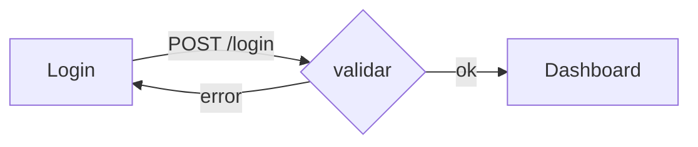

# Pantalla: Login

## 1. Identificación

| Campo | Valor |
|---|---|
| Ruta | `GET /login` (página), `POST /login` (acción) |
| Handler | `LoginPage` / `Login` (`internal/handlers/auth.go`) |
| Template | `templates/login.html` |
| Fragmentos | ninguno |
| Roles | público |
| Propósito | Autenticar usuarios con email + contraseña (bcrypt) y crear la sesión por cookie |
| Acceso | público |

## 2. Datos involucrados

- Modelo: `models.User`
- Query: `db.Where("email = ?", email).First(&user)`; compara contraseña con `bcrypt.CompareHashAndPassword`.
- Redirección post-login según rol (`dashboardPath` en `auth.go`):
  - `administrador`, `dueño`/`dueno`, `inquilino` → `/dashboard`
  - `receptor` → `/recibos/new`

## 3. Formulario

| Campo | Tipo | Obligatorio | Notas |
|---|---|---|---|
| `email` | email | sí | |
| `password` | password | sí | |
| (checkbox "Recordarme") | — | no | previsto en AGENTS.md, no implementado aún |

## 4. Acciones y navegación

| Acción | Destino | Método | HTMX |
|---|---|---|---|
| Iniciar sesión | `/login` | POST | no |
| Cerrar sesión | `/logout` | POST | no |

## 5. Flujo

## 6. Estado actual vs objetivo

- **Actual:** error se muestra vía `?error=1`; no hay "Recordarme"; el vínculo usuario↔unidad depende de que `departamento.email == user.email` (hoy vacíos).
- **Objetivo (v2.1):** sin cambios funcionales. Se documenta la pendiente de vincular `users` a `persona`.

## 7. Pendientes / notas

- Vincular `User` a `Persona` (en vez de coincidencia por email) para que dueños/inquilinos vean sus unidades correctamente.
