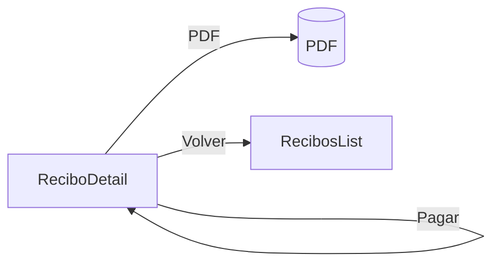

# Pantalla: Detalle de Recibo

## 1. Identificación

| Campo | Valor |
|---|---|
| Ruta | `GET /recibos/{id}`, `POST /recibos/{id}/pagar`, `GET /recibos/{id}/pdf` |
| Handler | `ReciboDetail`, `ReciboPagar`, `ReciboPDF` (`internal/handlers/recibos.go`, `recibos_pdf.go`) |
| Template | `templates/recibo_detail.html` |
| Fragmentos | `recibo_detalle.html` |
| Roles | administrador, dueño, dueno, inquilino, receptor |
| Propósito | Ver detalle, registrar pago y descargar PDF de un recibo |
| Acceso | autenticado (rol) |

## 2. Datos involucrados

- Modelos: `Recibo` + `Departamento` + `Detalles.Servicio` (preloads)
- Queries:
  - Detalle: `preload(Departamento).preload(Detalles.Servicio).first(id)`.
  - Pago: `preload(Detalles).first(id)` → setea `forma_pago` en todas las líneas (`E`/`T`).
  - PDF: `pdf.Recibo(recibo)` → `internal/pdf/recibo.go`.

## 3. Contenido mostrado

- Encabezado: número de recibo, fecha, estado (Pagado/Pendiente), forma de pago, total.
- Datos: unidad, piso, propietario.
- Tabla de ítems: concepto (servicio + descripción), cant., precio, importe, forma de pago.
- Si está pendiente: form para marcar pago (`E` Efectivo / `T` Transferencia).

## 4. Acciones y navegación

| Acción | Destino | Método | HTMX | Target |
|---|---|---|---|---|
| Descargar PDF | `/recibos/{id}/pdf` | GET | no | — |
| Marcar pagado | `/recibos/{id}/pagar` | POST | sí | `#recibo-detalle` |
| Volver | `/recibos` | GET | no | — |

## 5. Flujo

## 6. Estado actual vs objetivo

- **Actual:** muestra `Departamento.Numero` y `Departamento.Propietario`.
- **Objetivo (v2.1):** muestra `Departamento.Nombre` y titular `Persona.Nombre` (fallback legacy). Sin otros cambios; sigue siendo 1 recibo = 1 PDF.

## 7. Pendientes / notas

- El PDF (`internal/pdf/recibo.go`) usa `rec.Departamento.Numero` y `Propietario`; en v2.1 debe usar `Nombre` y el titular de la persona.
