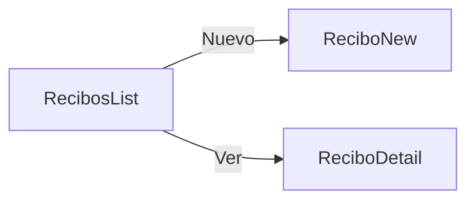

# Pantalla: Listado de Recibos

## 1. Identificación

| Campo | Valor |
|---|---|
| Ruta | `GET /recibos` |
| Handler | `RecibosList` (`internal/handlers/recibos.go`) |
| Template | `templates/recibos_list.html` |
| Fragmentos | `recibos_table.html`, `paginador.html` |
| Roles | administrador, dueño, dueno, inquilino, receptor |
| Propósito | Listar, filtrar y navegar recibos |
| Acceso | autenticado (rol) |

## 2. Datos involucrados

- Modelos: `Recibo` (+ `Departamento` + `Detalles.Servicio` preloads)
- Queries:
  - **Restricción por rol:** admin/receptor ven todo; dueño/inquilino solo los `id_departamento` cuyo `departamento.email == user.email` (si ningún depto, filtro `id IN (0)`).
  - Filtros: `departamento` (`id_departamento`), `mes` (rango por `fecha`), `estado` (`pagado`/`pendiente` según `forma_pago` en `detallerecibo`).
  - Orden: `fecha DESC, id DESC`; paginado `perPage = 25`.

## 3. Filtros

| Campo | Tipo | Notas |
|---|---|---|
| `departamento` | select | unidades activas; `0` = todos |
| `mes` | month | `YYYY-MM` |
| `estado` | select | vacío / pendiente / pagado |

## 4. Acciones y navegación

| Acción | Destino | Método | HTMX | Target |
|---|---|---|---|---|
| Filtrar | `/recibos` | GET | sí | `#recibos-table` |
| Nuevo recibo | `/recibos/new` | GET | no | — |
| Ver recibo | `/recibos/{id}` | GET | no | — |

## 5. Flujo

## 6. Estado actual vs objetivo

- **Actual:** columna "Unidad" = `trimNumero .Departamento.Numero` (código legacy); "Propietario" = `Departamento.Propietario`.
- **Objetivo (v2.1):** "Unidad" = `Departamento.Nombre`; "Propietario/Titular" = `Recibo.IDPersona → Persona.Nombre` con fallback a `Departamento.Propietario`. Filtro de deptos por rol pasa de email a `user → persona → departamento_persona`.

## 7. Pendientes / notas

- Mensaje de éxito al generar N recibos: `/recibos?msg=Se generaron N recibos`.
