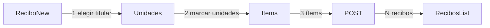

# Pantalla: Nuevo Recibo (generación)

## 1. Identificación

| Campo | Valor |
|---|---|
| Ruta | `GET /recibos/new` (formulario), `POST /recibos` (crear), `GET /recibos/item-row` (fila dinámica) |
| Handler | `ReciboNew`, `ReciboCreate`, `ReciboItemRow` (`internal/handlers/recibos.go`) |
| Template | `templates/recibo_create.html` |
| Fragmentos | `item_row.html` |
| Roles | administrador, dueño, dueno, inquilino, receptor |
| Propósito | Generar recibos. v2.0: uno por unidad. v2.1: varios recibos (uno por unidad) de un mismo titular |
| Acceso | rol |

## 2. Estado actual (v2.0)

- Formulario: **select de 1 departamento** + fecha + observaciones + N filas de ítems.
- `POST /recibos` crea **un** `Recibo` con sus `DetalleRecibo`; `nextNumeroRecibo` numera `REC-YYYY-NNNN` por conteo anual.
- Validaciones: 1 ítem mínimo; `fecha` válida; departamento obligatorio.

## 3. Estado objetivo (v2.1) — flujo en 3 pasos

**Paso 1 — Elegir titular (persona)**
- Select de `persona` (propietario/inquilino activos).
- HTMX: al cambiar, carga las unidades vinculadas vía `departamento_persona` (rol del titular) → fragmento con checkboxes.

**Paso 2 — Marcar unidades**
- Checkboxes de unidades activas del titular seleccionado.
- **Regla de negocio:** todas las unidades pertenecen al mismo titular (la lista ya viene filtrada por persona). Es imposible mezclar titulares distintos.
- Requiere al menos 1 unidad marcada.

**Paso 3 — Ítems + datos**
- Fecha, observaciones y filas de ítems (reutiliza `item_row` y el JS de recálculo de totales).
- Ítems compartidos: se aplican a cada unidad seleccionada.

**POST /recibos (v2.1)**
- Re-validación en servidor: todas las unidades marcadas deben pertenecer a la persona elegida (no confiar solo en la UI).
- Bucle por unidad: crea **un** `Recibo` por unidad, clonando los ítems; `id_persona` = titular; numeración secuencial (`nextNumeroRecibo` incrementa por iteración).
- Redirige a `/recibos?msg=Se generaron N recibos`.

## 4. Formulario (objetivo)

| Campo | Tipo | Obligatorio | Notas |
|---|---|---|---|
| `id_persona` | select | sí | titular emisor |
| `id_departamento[]` | checkboxes | sí (≥1) | unidades del titular, HTMX |
| `fecha` | date | sí | |
| `observaciones` | text | no | |
| ítems: `id_servicio[]` | select | ≥1 | |
| ítems: `cantidad[]` | number | sí | |
| ítems: `precio[]` | number | sí | |
| ítems: `descripcion[]` | text | no | |

## 5. Acciones y navegación

| Acción | Destino | Método | HTMX | Target |
|---|---|---|---|---|
| Cargar unidades del titular | `/recibos/new?persona={id}` | GET | sí | `#unidades` |
| Agregar ítem | `/recibos/item-row` | GET | sí | `#items` (beforeend) |
| Generar | `/recibos` | POST | no | — |

## 6. Flujo (objetivo)

## 7. Pendientes / notas

- Campo `id_persona` en `recibo` (nullable) para registrar el titular.
- Cambiar la numeración a `MAX(numero_recibo)` (hoy es conteo) para evitar colisiones al generar N en paralelo.
- Mensaje agregado del listado: "Se generaron N recibos".
