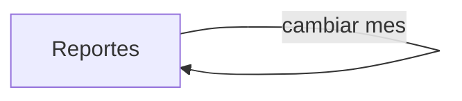

# Pantalla: Reportes

## 1. Identificación

| Campo | Valor |
|---|---|
| Ruta | `GET /reportes` |
| Handler | `Reportes` (`internal/handlers/reportes.go`) |
| Template | `templates/reportes.html` |
| Fragmentos | `reportes_content.html`, `paginador.html` |
| Roles | administrador |
| Propósito | Reporte mensual: totales, cobrado/pendiente y montos por servicio |
| Acceso | rol |

## 2. Datos involucrados

- Modelos: `Recibo`, `DetalleRecibo`, `Servicio`
- Queries:
  - Total mensual: `SUM(recibo.total)` del rango de `mes`.
  - Cobrado: `SUM(detallerecibo.precio*cantidad)` con `forma_pago <> ''` unido a `recibo` del rango.
  - Pendiente = Total − Cobrado.
  - Por servicio: `SUM(importe)` agrupado por `servicio.nombre`.
  - Listado de recibos del mes paginado (orden `fecha ASC, id ASC`).

## 3. Filtros

| Campo | Tipo | Notas |
|---|---|---|
| `mes` | month | `YYYY-MM`; default mes actual |

## 4. Acciones y navegación

| Acción | Destino | Método | HTMX | Target |
|---|---|---|---|---|
| Cambiar mes | `/reportes?mes=` | GET | sí | `#reportes-content` |

## 5. Flujo

## 6. Estado actual vs objetivo

- **Actual:** funcionando; solo admin por ruta.
- **Objetivo (v2.1):** sin cambios de modelo. Pendiente (AGENTS.md): consultas para dueño (solo lo suyo) e inquilino (❌ en reportes según matriz).

## 7. Pendientes / notas

- Matriz de roles AGENTS.md: Reportes → admin ✅, propietario ✅ (solo suyo), inquilino ❌, operador ✅.
