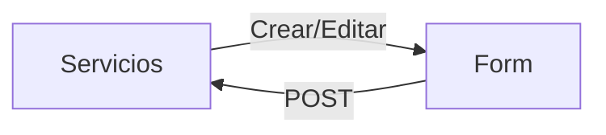

# Pantalla: Servicios

## 1. Identificación

| Campo | Valor |
|---|---|
| Ruta | `GET /servicios`, `POST /servicios`, `POST /servicios/{id}` |
| Handler | `ServiciosList`, `ServicioCreate`, `ServicioUpdate` (`internal/handlers/servicios.go`) |
| Template | `templates/servicios.html` |
| Fragmentos | ninguno |
| Roles | administrador |
| Propósito | CRUD de servicios/conceptos facturables con precio unitario |
| Acceso | rol |

## 2. Datos involucrados

- Modelo: `models.Servicio`
- Query: listado `order(nombre ASC)`; edición vía `?edit={id}`.

## 3. Formulario

| Campo | Tipo | Obligatorio | Notas |
|---|---|---|---|
| `nombre` | text | sí | validación server-side |
| `precio_unitario` | number | no | default 0 |
| `activo` | checkbox | no | default checked |

## 4. Acciones y navegación

| Acción | Destino | Método | HTMX |
|---|---|---|---|
| Crear | `/servicios` | POST | no |
| Editar | `/servicios/{id}` | POST | no |
| Editar (formulario) | `/servicios?edit={id}` | GET | no |

## 5. Flujo

## 6. Estado actual vs objetivo

- **Actual:** pantalla completa sin cambios pendientes.
- **Objetivo (v2.1):** sin cambios de modelo; el servicio se sigue usando en `detallerecibo`.

## 7. Pendientes / notas

- AGENTS.md prevé "Ver Servicios" para todos los roles (lectura) y edición solo admin. Hoy la ruta exige admin.
